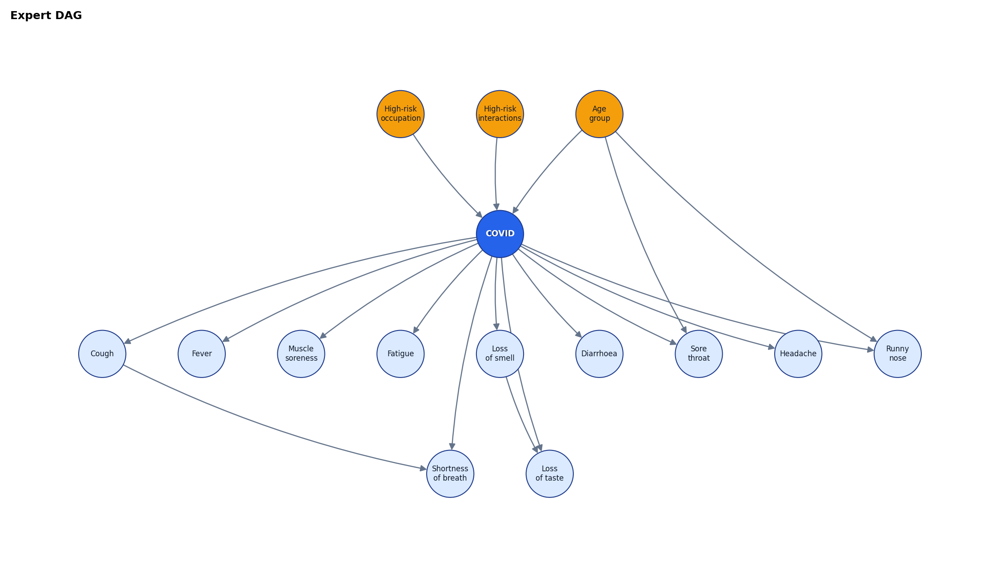
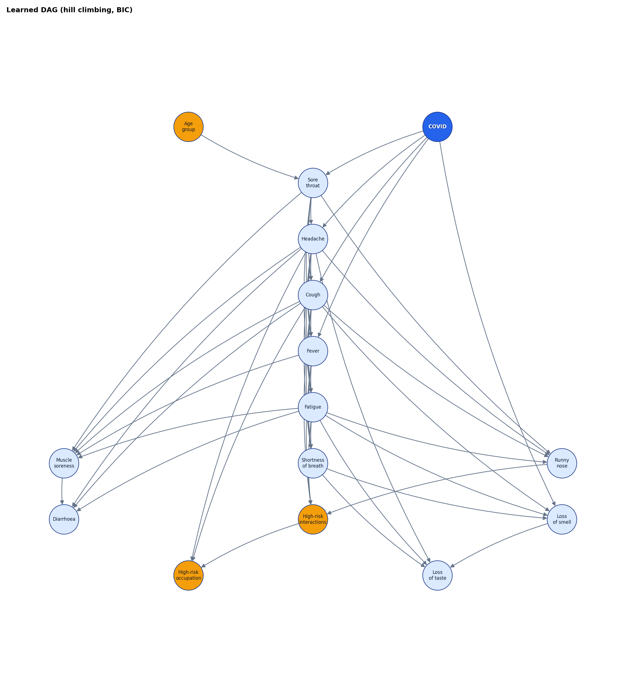
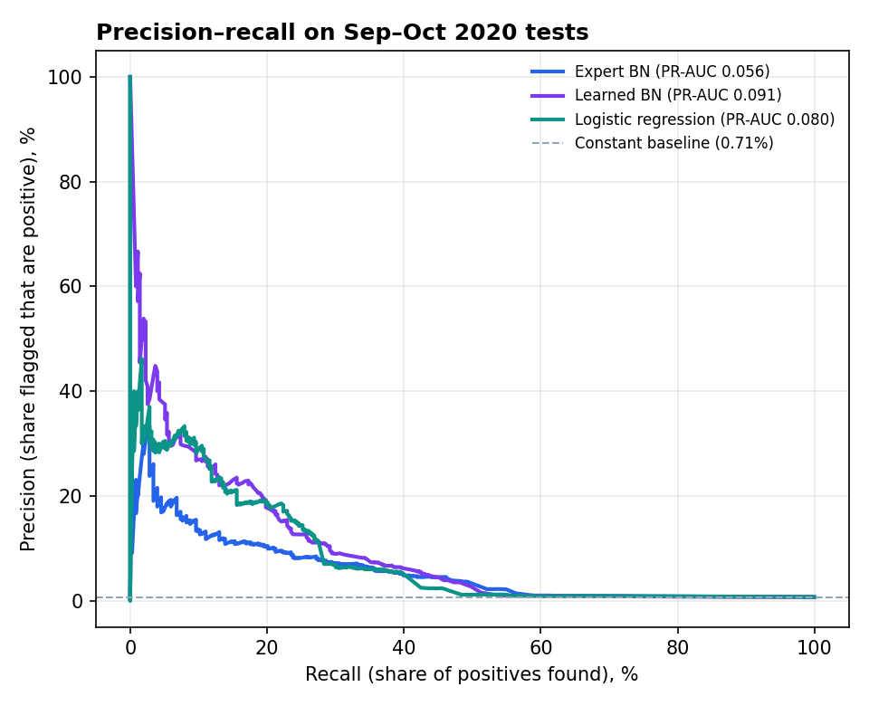
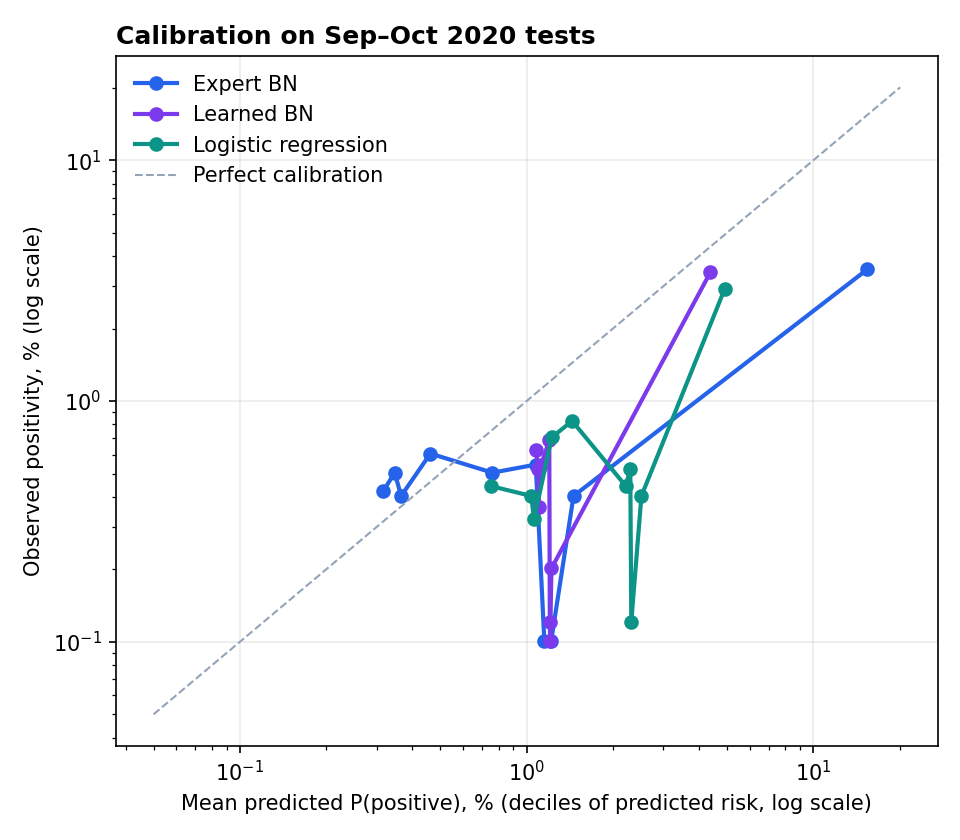

# Bayesian network for COVID test results

_Generated by `modeling/train_bayes.py` on 2026-11-07 with pgmpy 1.1.2._

## Summary

- **Chosen structure: Learned BN.** PR-AUC differs reliably (Expert − Learned = -0.0352, 95% bootstrap interval -0.0606 to -0.0144), so PR-AUC decides.
- On Sep–Oct 2020 tests it reaches PR-AUC **0.091** (12.8× the constant baseline's 0.0071) and ROC-AUC **0.660**. Logistic regression on the same variables: PR-AUC 0.080, ROC-AUC 0.659.
- Every model **over-predicts** in the test months: training positivity was 1.96%, test positivity 0.71%. The chosen network's average prediction is 2.1× the observed rate.
- The final model was refitted on all 70,976 complete rows and saved to `backend/data/bayes_model.bif`; reloading it gives the same answers (largest difference 5.6e-17 over 2,000 test rows).

## 1. Data

|  | Count |
|---|---:|
| Rows in clean.parquet | 93,995 |
| Dropped: age group Unknown | 29 |
| Dropped: true repeated records (exact duplicate and all six vitals present) | 40 |
| Rows kept | 93,926 |
| Training rows (≤ 2020-08-31, every symptom recorded) | 40,805 (798 positive, 1.96%) |
| Test rows (Sep–Oct 2020, all) | 49,565 (353 positive, 0.71%) |
| Test rows with every symptom recorded | 30,171 |
| Final model rows (all months, every symptom recorded) | 70,976 (1106 positive) |

Other exact duplicates are kept, as on the dashboard: without a patient ID they may be different people with identical answers. They are common in the test months (48% of test rows).

**Missing answers.** Training uses only rows where every symptom is recorded; a missing symptom is never read as "No". At test time each row is scored with whatever it has: unrecorded symptoms are simply left out of the evidence, so the network averages over them. Fever is the gap that matters: it is missing in 8% of training-period rows but 39% of test rows.

**Why exposure has an Unknown state.** Requiring both exposure answers would drop 2,401 of 40,805 training rows (5.9%), but 104 of 798 positives (13.0%), because those rows are 4.33% positive versus 1.81% for the rest. Losing an eighth of the positives, and the rows where they concentrate, costs too much, so each exposure variable is Yes / No / Unknown.

## 2. Structures

Both are fitted with `BayesianEstimator` (BDeu prior, equivalent sample size 10) on the training rows.

**Expert DAG:** age group → COVID; both exposure variables → COVID; COVID → each of the 11 symptoms; loss of smell → loss of taste; cough → shortness of breath; age group → runny nose and sore throat.

**Learned DAG:** hill climbing with the BIC score; no edge may point into age group, and no symptom may point into COVID. It found 47 edges (the expert DAG has 18).

| Comparison | Edges |
|---|---:|
| Edges in both (either direction) | 8 |
| Learned only | cough → diarrhea, cough → fatigue, cough → fever, cough → high_risk_exposure_occupation, cough → high_risk_interactions, cough → loss_of_smell, cough → muscle_sore, cough → runny_nose, fatigue → diarrhea, fatigue → high_risk_interactions, fatigue → loss_of_smell, fatigue → loss_of_taste, fatigue → muscle_sore, fatigue → runny_nose, fatigue → sob, fever → fatigue, fever → high_risk_interactions, fever → muscle_sore, fever → sob, headache → cough, headache → diarrhea, headache → fatigue, headache → fever, headache → high_risk_exposure_occupation, headache → loss_of_taste, headache → muscle_sore, headache → runny_nose, headache → sob, high_risk_interactions → high_risk_exposure_occupation, muscle_sore → diarrhea, runny_nose → high_risk_interactions, sob → loss_of_smell, sob → loss_of_taste, sore_throat → cough, sore_throat → fatigue, sore_throat → fever, sore_throat → headache, sore_throat → muscle_sore, sore_throat → runny_nose |
| Expert only | age_group → covid, age_group → runny_nose, covid → diarrhea, covid → fatigue, covid → loss_of_taste, covid → muscle_sore, covid → runny_nose, covid → sob, high_risk_exposure_occupation → covid, high_risk_interactions → covid |
| Same pair, opposite direction (learned) | none |
| COVID's parents in the learned DAG | none |
| COVID's children in the learned DAG | cough, fever, headache, loss_of_smell, sore_throat |

**How stable is the learned DAG?** Hill climbing breaks ties between equally good moves in an arbitrary order (Python's string hashing). The saved model uses PYTHONHASHSEED=0; the same search with 5 other seeds gives:

| Seed | Edges | BIC (train) | COVID's parents | COVID's children | Test PR-AUC | Test ECE |
|---|---:|---:|---:|---:|---:|---:|
| **0 (used)** | 47 | -176,215 | none | cough, fever, headache, loss_of_smell, sore_throat | 0.0915 | 0.760% |
| 1 | 47 | -176,215 | none | cough, fever, headache, loss_of_smell, sore_throat | 0.0915 | 0.760% |
| 2 | 45 | -176,351 | none | cough, fever, headache, loss_of_smell, loss_of_taste | 0.0869 | 0.774% |
| 3 | 41 | -176,472 | none | cough, fever, headache, loss_of_smell, loss_of_taste, muscle_sore | 0.0844 | 0.761% |
| 4 | 47 | -176,215 | none | cough, fever, headache, loss_of_smell, sore_throat | 0.0915 | 0.760% |
| 5 | 44 | -176,261 | none | cough, fever, loss_of_smell | 0.0750 | 0.851% |

22 edges appear in every run, out of 66 seen at least once. For comparison, the expert DAG's BIC on the same data is -192,820 (higher is better).

## 3. Test results (Sep–Oct 2020)

Score = P(COVID = Positive | every other recorded variable), by variable elimination. The constant baseline predicts the training positivity for everyone. Logistic regression uses the same variables (one-hot age group and Yes/No/Unknown exposure, symptoms 0/1); for symptoms missing at test time it uses the training average, not "No".

**All 49,565 test rows** (the main comparison):

| Model | PR-AUC | ROC-AUC | Brier | ECE (10 bins) | Mean predicted | Observed |
|---|---:|---:|---:|---:|---:|---:|
| Expert BN | 0.0562 | 0.681 | 0.01230 | 1.639% | 2.26% | 0.71% |
| Learned BN | 0.0915 | 0.660 | 0.00680 | 0.760% | 1.47% | 0.71% |
| Logistic regression | 0.0797 | 0.659 | 0.00701 | 1.266% | 1.98% | 0.71% |
| Constant baseline | 0.0071 | 0.500 | 0.00723 | 1.243% | 1.96% | 0.71% |

**Only the 30,171 test rows with every symptom recorded** (no model has to deal with missing symptoms):

| Model | PR-AUC | ROC-AUC | Brier | ECE (10 bins) | Mean predicted | Observed |
|---|---:|---:|---:|---:|---:|---:|
| Expert BN | 0.0628 | 0.741 | 0.01873 | 2.048% | 2.90% | 1.02% |
| Learned BN | 0.0993 | 0.723 | 0.00967 | 0.614% | 1.63% | 1.02% |
| Logistic regression | 0.0917 | 0.749 | 0.00974 | 0.630% | 1.65% | 1.02% |
| Constant baseline | 0.0102 | 0.500 | 0.01019 | 0.935% | 1.96% | 1.02% |

PR-AUC (average precision) is the main score because positives are rare; for the constant baseline it equals the positivity. Brier is the mean squared error of the probability. ECE is the average gap between predicted and observed positivity over the 10 bins below.

Paired bootstrap (1000 resamples) of PR-AUC, expert − learned: -0.0352 (95% interval -0.0606 to -0.0144).

**Sensitivity: the same networks, all test rows, when a missing exposure answer is left out of the evidence** instead of being entered as "Unknown":

| Model | PR-AUC | ROC-AUC | Brier | ECE (10 bins) | Mean predicted | Observed |
|---|---:|---:|---:|---:|---:|---:|
| Expert BN | 0.0573 | 0.717 | 0.01213 | 1.272% | 1.92% | 0.71% |
| Learned BN | 0.0928 | 0.680 | 0.00679 | 0.735% | 1.45% | 0.71% |

### Calibration (10 equal-size bins of predicted risk)

**Expert BN**

| Decile | Predicted range | Tests | Positives | Mean predicted | Observed | Observed ÷ predicted |
|---|---:|---:|---:|---:|---:|---:|
| 1 | 0.20% – 0.33% | 4957 | 21 | 0.32% | 0.42% | 1.34 |
| 2 | 0.33% – 0.37% | 4956 | 25 | 0.35% | 0.50% | 1.45 |
| 3 | 0.37% – 0.37% | 4957 | 20 | 0.37% | 0.40% | 1.10 |
| 4 | 0.37% – 0.46% | 4956 | 30 | 0.46% | 0.61% | 1.31 |
| 5 | 0.46% – 0.96% | 4957 | 25 | 0.76% | 0.50% | 0.66 |
| 6 | 0.96% – 1.15% | 4956 | 27 | 1.08% | 0.54% | 0.51 |
| 7 | 1.15% – 1.15% | 4957 | 5 | 1.15% | 0.10% | 0.09 |
| 8 | 1.15% – 1.23% | 4956 | 5 | 1.22% | 0.10% | 0.08 |
| 9 | 1.23% – 1.55% | 4957 | 20 | 1.46% | 0.40% | 0.28 |
| 10 | 1.55% – 99.98% | 4956 | 175 | 15.46% | 3.53% | 0.23 |

**Learned BN**

| Decile | Predicted range | Tests | Positives | Mean predicted | Observed | Observed ÷ predicted |
|---|---:|---:|---:|---:|---:|---:|
| 1 | 0.73% – 1.10% | 4957 | 31 | 1.08% | 0.63% | 0.58 |
| 2 | 1.10% – 1.10% | 4956 | 26 | 1.10% | 0.52% | 0.48 |
| 3 | 1.10% – 1.10% | 4957 | 18 | 1.10% | 0.36% | 0.33 |
| 4 | 1.10% – 1.11% | 4956 | 26 | 1.11% | 0.52% | 0.47 |
| 5 | 1.11% – 1.20% | 4957 | 27 | 1.12% | 0.54% | 0.48 |
| 6 | 1.20% – 1.21% | 4956 | 34 | 1.20% | 0.69% | 0.57 |
| 7 | 1.21% – 1.21% | 4957 | 6 | 1.21% | 0.12% | 0.10 |
| 8 | 1.21% – 1.21% | 4956 | 5 | 1.21% | 0.10% | 0.08 |
| 9 | 1.21% – 1.23% | 4957 | 10 | 1.22% | 0.20% | 0.17 |
| 10 | 1.23% – 69.43% | 4956 | 170 | 4.38% | 3.43% | 0.78 |

**Logistic regression**

| Decile | Predicted range | Tests | Positives | Mean predicted | Observed | Observed ÷ predicted |
|---|---:|---:|---:|---:|---:|---:|
| 1 | 0.19% – 1.00% | 4957 | 22 | 0.75% | 0.44% | 0.59 |
| 2 | 1.00% – 1.05% | 4956 | 20 | 1.04% | 0.40% | 0.39 |
| 3 | 1.05% – 1.06% | 4957 | 16 | 1.06% | 0.32% | 0.30 |
| 4 | 1.06% – 1.35% | 4956 | 35 | 1.22% | 0.71% | 0.58 |
| 5 | 1.35% – 2.05% | 4957 | 41 | 1.44% | 0.83% | 0.57 |
| 6 | 2.05% – 2.30% | 4956 | 22 | 2.22% | 0.44% | 0.20 |
| 7 | 2.30% – 2.32% | 4957 | 26 | 2.30% | 0.52% | 0.23 |
| 8 | 2.32% – 2.32% | 4956 | 6 | 2.32% | 0.12% | 0.05 |
| 9 | 2.32% – 2.94% | 4957 | 20 | 2.52% | 0.40% | 0.16 |
| 10 | 2.94% – 89.60% | 4956 | 145 | 4.91% | 2.93% | 0.60 |

**Constant baseline:** predicts 1.96% for all 49,565 tests; observed 0.71%.

## 4. Sanity check: loss of smell

| Source | P(positive | loss of smell = Yes) | P(positive | No) | Ratio |
|---|---:|---:|---:|
| Expert BN | 22.30% | 1.74% | 12.8× |
| Learned BN | 23.38% | 1.72% | 13.6× |
| Training data (empirical) | 21.98% | 1.73% | 12.7× |
| Final model (all data) | 23.45% | 1.37% | 17.1× |

Both networks reproduce the direction and size of the training data's effect (23.38% vs 1.72% for the chosen model).

## 5. Final model

|  |  |
|---|---:|
| Structure | Learned BN |
| Rows / positives | 70,976 / 1106 |
| Saved | `backend/data/bayes_model.bif`, `backend/data/bayes_meta.json` |
| Reload: same edges | yes |
| Reload: same states | yes |
| Reload: largest CPD difference | 0.0e+00 |
| Reload: largest prediction difference | 5.6e-17 (2,000 test rows) |

Age states in the file are ASCII (`0-18`, `19-30`, `31-45`, `46-60`, `61+`); `bayes_meta.json` maps them to the dashboard labels.

## 6. Findings in plain English

1. **Symptoms give a real but modest signal.** The chosen network ranks Sep–Oct tests about 13× better than guessing (PR-AUC 0.091 vs 0.0071), yet even its riskiest tenth of tests is only 3.43% positive. This is a triage aid, not a diagnosis. Loss of smell is the clearest single sign: 23.38% positive when present vs 1.72% when absent, which both networks reproduce.
2. **The learned DAG ranks the riskiest tests better; the expert DAG ranks the bulk better.** PR-AUC 0.091 learned vs 0.056 expert (bootstrap interval of the gap -0.061 to -0.014); ROC-AUC 0.660 vs 0.681. The interval excludes zero, so PR-AUC picked the learned DAG. Logistic regression on the same variables lands at PR-AUC 0.080, ROC-AUC 0.659: the network is not more accurate than a simple regression; its advantage is answering any partial question ("only age and cough are known") and handling missing answers without retraining.
3. **In the learned network nothing points into COVID.** Age and exposure have no direct link to it; COVID depends only on its Markov blanket (age_group, cough, fatigue, fever, headache, loss_of_smell, sob, sore_throat). Age points to sore_throat, so it enters only as a co-parent of a COVID symptom. The exposure variables sit below symptoms (cough → high_risk_exposure_occupation, cough → high_risk_interactions, fatigue → high_risk_interactions, fever → high_risk_interactions, headache → high_risk_exposure_occupation, high_risk_interactions → high_risk_exposure_occupation, runny_nose → high_risk_interactions): associations the score found useful, not causes. Training positivity by age ranges only 1.42%–3.35%, too little for BIC to pay for a 5-state parent once symptoms are known. A side effect: the learned network outputs just 405 distinct probabilities across 49,565 tests (median 1.20%).
4. **The probabilities run high for the test months.** Positivity fell from 1.96% in Apr–Aug to 0.71% in Sep–Oct; a model trained on the earlier months carries the higher base rate forward (mean prediction 1.47%). Ranking survives this shift; the absolute numbers do not. The saved model is refitted on all months, which lowers its base rate, but any live use should recalibrate to recent positivity.
5. **"Unknown" exposure flips meaning over time, and it hurts the expert DAG.** In training, a missing high-risk-interactions answer (6% of rows) went with 4.33% positivity vs 1.81% when answered, because answers were most often missing in April–May when positivity was highest. In Sep–Oct the answer is missing in 42% of rows and those rows are only 0.29% positive (vs 1.02%). The expert DAG, where exposure points straight at COVID, raises risk for all of them. Leaving Unknown out of the evidence moves its ECE from 1.639% to 1.272% and its PR-AUC from 0.056 to 0.057. The learned DAG barely notices because exposure is screened off by the symptoms. For live use, treat a missing exposure answer as missing evidence, not as "Unknown".
6. **Fever is often unrecorded in the test months** (39% vs 8% in training). On the 30,171 test rows with every symptom recorded all models score higher (chosen network PR-AUC 0.099, ROC-AUC 0.723), and those rows are also more often positive (1.02% vs 0.71%).
7. **The learned structure is not stable.** Re-running the same search with different tie-breaking gives 41–47 edges, only 22 of 66 edges in every run, COVID with 3–6 children, and test PR-AUC from 0.075 to 0.091. Many symptom-to-symptom arrows are interchangeable ways of encoding the same correlations, so do not read individual learned arrows as findings. The seed is pinned so the saved model is reproducible.
